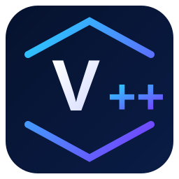
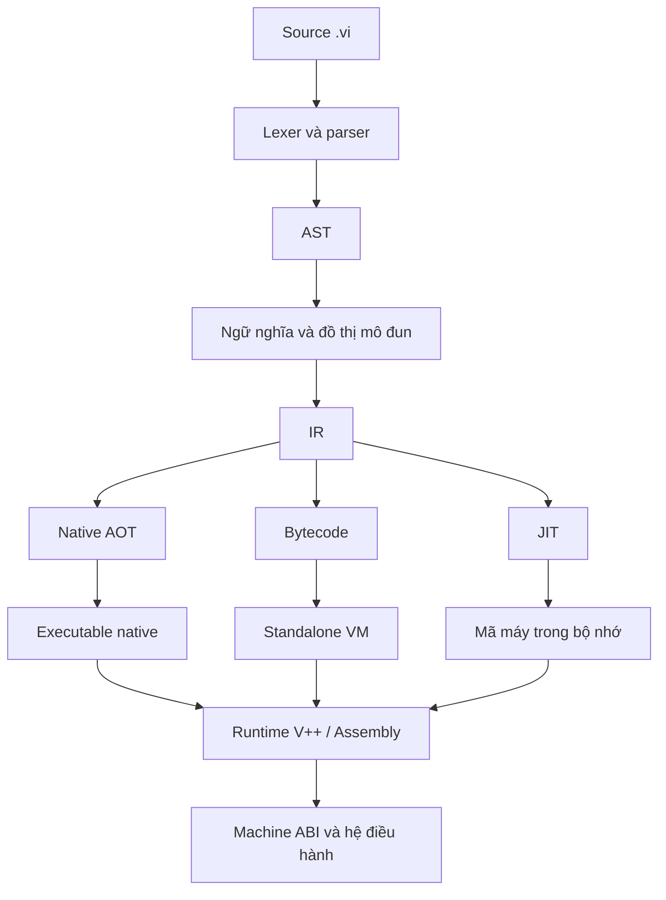

<div align="center">
  

# V++

**Ngôn ngữ lập trình tiếng Việt — bộ biên dịch tự chủ, máy ảo bytecode và JIT viết bằng V++/Assembly.**

*Vietnamese-first programming language with a self-hosted compiler, bytecode VM and native JIT.*

[](https://github.com/winbiru/VXX/actions/workflows/native-vpp.yml)
[](https://github.com/winbiru/VXX/releases)
[](LICENSE)
[](CMakeLists.txt)

[Chạy thử](#chạy-thử) · [Cài đặt](#cài-đặt-và-build) · [Kiến trúc](#kiến-trúc) · [Worker](#thực-thi-đồng-thời) · [Benchmark](#benchmark) · [Tài liệu](#tài-liệu)
</div>

---

## V++ là gì?

V++ là ngôn ngữ lập trình mã nguồn mở sử dụng từ khóa và định danh tiếng Việt, với mục tiêu giúp người Việt học lập trình, xây dựng ứng dụng và tiếp cận công nghệ hệ thống bằng ngôn ngữ của mình. Phần mở rộng mã nguồn là `.vi`.

Bộ biên dịch, máy ảo, JIT, runtime và thư viện chuẩn hiện được phát triển bằng chính V++ và Assembly. Assembly cung cấp các primitive ở ranh giới máy và hệ điều hành. Quá trình khởi tạo sử dụng các seed đã ghim checksum trong repository để xây dựng bộ công cụ hiện tại; không cần biên dịch implementation C/C++ cũ.

V++ hỗ trợ hàm, closure, lớp và đối tượng, danh sách, bản đồ, ngoại lệ, Unicode, import mô đun, thu gom bộ nhớ và các API hệ thống. Có ba đường thực thi: Native AOT, máy ảo bytecode và JIT. Phạm vi tính năng và mức kiểm chứng khác nhau giữa các đường thực thi và nền tảng.

## Chạy thử

Tạo tệp `xin-chao.vi`:

```vpp
hàm chính() {
    in "Xin chào V++!";
};
```

Sau khi build trên macOS ARM64, chạy từ thư mục repository:

```sh
./VPP run xin-chao.vi
```

Biên dịch thành chương trình thực thi độc lập và chạy:

```sh
./VPP build xin-chao.vi -o xin-chao
./xin-chao
```

Ví dụ về hàm và điều kiện:

```vpp
hàm gấp đôi(x) {
    trả về x * 2;
};

hàm chính() {
    kết_quả = gấp đôi(21);
    nếu (kết_quả == 42) {
        in kết_quả;
    };
};
```

Xem thêm [các chương trình ví dụ](examples/) và [tham chiếu ngôn ngữ](docs/language-reference.md).

## Cài đặt và build

Có thể xem các bản phát hành tại [GitHub Releases](https://github.com/winbiru/VXX/releases). Khi xây dựng từ source, chọn đúng quy trình theo hệ điều hành và kiến trúc CPU.

### Gói phát hành VPP và VDK

CI tạo các gói từ bộ biên dịch native hiện tại đã qua kiểm tra bootstrap, không sử dụng binary phát hành cũ. Mỗi gói có tệp `.sha256` tương ứng.

| Nền tảng | VPP | VDK 1.0.0 |
| --- | --- | --- |
| Linux x86_64 | `vpp-linux-x64.tar.gz` | `vdk-1.0.0-linux-x64.tar.gz` |
| macOS ARM64 | `vpp-macos.tar.gz` | `vdk-1.0.0-macos-arm64.tar.gz` |
| Windows x86_64 | `vpp-windows-x64.zip` | `vdk-1.0.0-windows-x64.zip` |

Cả hai gói có compiler, runtime, VM, JIT và thư viện chuẩn. VDK bổ sung manifest, tài liệu, template dự án, ví dụ, metadata editor và CLI quản lý viết bằng V++ (`vdk-info`), với launcher theo nền tảng. Sau khi giải nén, thêm thư mục `bin` vào `PATH`:

```sh
vdk trợ giúp
vdk phiên bản
vdk chẩn đoán
vdk thư viện danh sách
vdk thư viện danh sách --json
vdk cài hiển thị
vdk kiểm tra hiển thị
vdk biên dịch hello.vi --đầu-ra hello
vdk chạy hello.vi
vdk chạy tức thời hello.vi
vdk kiểm tra hello.vi
vdk biên-dịch-máy-ảo hello.vi --đầu-ra hello.vmb
vdk gỡ hiển thị
```

Lệnh tiếng Việt là giao diện chính; alias tiếng Anh vẫn tương thích. Cài hiển thị là tùy chọn, chỉ sửa profile người dùng. Mở terminal mới sau khi cài/gỡ. Nếu chưa gõ được dấu, dùng `vdk cai-hien-thi`. Tùy chọn `--vdk-home` tương đương `--thư-mục-vdk`.

Khóa phiên bản SDK theo dự án bằng tệp `vdk.json`:

```json
{"version": "1.0.0"}
```

VDK tìm tệp gần nhất từ thư mục làm việc lên các thư mục cha. Khi có pin, VDK chọn
bản phù hợp từ `~/.vpp/vdk/<version>` (Linux/macOS) hoặc
`%LOCALAPPDATA%/VPP/vdk/<version>` (Windows), rồi đến `VDK_HOME`, `VPP_HOME` và
SDK chứa launcher. `vdk --thư-mục-vdk <đường-dẫn> phiên bản` chỉ định SDK tường minh
và vẫn phải khớp pin. Pin sai hoặc thiếu phiên bản yêu cầu sẽ trả lỗi.
Xem [hướng dẫn VDK](docs/installation.md#cài-đặt-vdk-và-chọn-phiên-bản-sdk).

Linux/Windows vẫn cần toolchain clang/LLD phù hợp cho AOT; không đóng kèm toolchain bên ngoài. Kiểm tra SHA-256 bằng `sha256sum -c <tên-gói>.sha256` (Linux), `shasum -a 256 -c <tên-gói>.sha256` (macOS), hoặc so sánh `Get-FileHash <tên-gói> -Algorithm SHA256` trên Windows.

Build gói trên macOS: `cmake --build build-pure-vpp --target vpp-release-packages`. Kết quả nằm tại `build-pure-vpp/release-candidates/`. CI tải các gói ứng viên lên Actions; sự kiện publish GitHub Release chỉ đính kèm gói sau khi regression thành công và checksum hợp lệ, không ghi đè asset có sẵn.

### macOS ARM64 (Apple Silicon)

Yêu cầu CMake 3.20 trở lên, Bash và Xcode Command Line Tools. CMake ở root hiện được cấu hình dành cho nền tảng này.

```sh
git clone https://github.com/winbiru/VXX.git
cd VXX
cmake -S . -B build-pure-vpp
cmake --build build-pure-vpp --parallel
./VPP phiên bản
```

Có thể dùng `make build` để build theo cấu hình mặc định. Launcher `./VPP` tìm bộ công cụ trong `build-pure-vpp`; dùng `VPP_BUILD_DIR` nếu chọn thư mục build khác.

Cài bộ công cụ vào thư mục cá nhân:

```sh
cmake --install build-pure-vpp --prefix "$HOME/.local"
export PATH="$HOME/.local/bin:$PATH"
vpp --help
```

Kết quả build gồm `vpp` (launcher), `vpp-native` (compiler đầy đủ), `vpp-i32` (compiler native i32), `vpp-vm` (VM độc lập), `vpp-jit` (JIT) trong `build-pure-vpp/bin/`, cùng các object runtime trong `build-pure-vpp/native-vpp-runtime/`.

### Linux x86_64

Quy trình bootstrap riêng dùng Bash, Clang, linker ELF, binutils, Python 3 và GNU coreutils. Chạy từ root repository với thư mục đầu ra mới:

```sh
bash scripts/quality/check_linux_full_bootstrap.sh /tmp/vpp-linux-full-bootstrap
```

Quy trình tạo và kiểm tra compiler đầy đủ, ELF tĩnh, các thế hệ tự biên dịch và gói phân phối. Không yêu cầu máy macOS để chạy trên Linux.

### Windows x86_64

Dùng PowerShell, Python 3, CMake và toolchain Clang/LLD (MSYS2 CLANG64) có trong PATH. Chạy từ root repository với đường dẫn đầu ra mới:

```powershell
python scripts/quality/check_windows_full_bootstrap.py --clang (Get-Command clang.exe).Source bootstrap "$env:TEMP/vpp-windows-full" --archive "$env:TEMP/vpp-windows-full.zip"
```

Quy trình kiểm tra PE/COFF, bootstrap compiler đầy đủ và đóng gói Windows. Chi tiết seed, yêu cầu công cụ và từng giai đoạn xem tại [bootstrap/README.md](bootstrap/README.md).

### Trạng thái nền tảng

| Nền tảng | Đường triển khai hiện tại | Mức kiểm chứng |
| --- | --- | --- |
| macOS ARM64 | CMake, full AOT Mach-O, VM, JIT, OS worker | Build và worker chạy thực tế; benchmark được đo trên nền tảng này |
| Linux x86_64 | Bootstrap riêng, full AOT ELF tĩnh, VM, OS worker | Worker VM/AOT chạy trong container; seed stage 1 được kiểm tra, cần xác nhận full convergence và regression trên CI |
| Windows x86_64 | Bootstrap riêng, full AOT PE/COFF, VM, OS worker | Cross-assemble và fixture stage 1 qua Wine; cần xác nhận full convergence và regression trên Windows native |
| macOS x86_64 | Machine ABI và OS worker dùng pthread | Machine regression qua Rosetta; chưa có full bootstrap tương đương ARM64 |
| Linux ARM64 | Có mã backend/ABI trong source | Chưa có OS worker; chưa xác nhận full bootstrap |

Phiên bản khai báo trong CMake là `1.0.0`. Ma trận trên mô tả mức hỗ trợ của cây mã nguồn hiện tại, không đồng nghĩa mọi nền tảng đã đạt đủ tiêu chí phát hành. Các seed full Linux/Windows đã được làm mới ngày 16/11/2026; kết quả hội tụ stage 2/3 trên CI vẫn cần xác nhận.

## Các chế độ thực thi

| Chế độ | Cách hoạt động | Đầu ra |
| --- | --- | --- |
| Native AOT | Biên dịch chương trình trước khi chạy, liên kết với runtime V++/ASM | Executable native |
| Bytecode VM | Biên dịch chương trình sang bytecode và thực thi bằng VM V++/ASM | `.vmb` |
| JIT | Phát mã máy khi chạy, thực thi trong vùng nhớ mã của tiến trình | Mã máy trong bộ nhớ |
| Native i32 | Biên dịch hàm i32 theo backend native chuyên biệt | Object, mã raw hoặc Assembly |

Ví dụ dùng bộ công cụ local trên macOS ARM64:

```sh
# Native AOT
./VPP run xin-chao.vi

# Standalone VM
./VPP vm-build xin-chao.vi -o xin-chao.vmb
build-pure-vpp/bin/vpp-vm xin-chao.vmb

# JIT với runtime động
./VPP jit --dynamic xin-chao.vi

# Kiểm tra compiler và mã trung gian
./VPP dump-ast xin-chao.vi
./VPP dump-ir xin-chao.vi
./VPP --help
```

JIT mặc định có đường i32; `--dynamic` cung cấp runtime cho số, chuỗi, danh sách, bản đồ, đối tượng, closure, ngoại lệ, GC và import. JIT phát mã máy trực tiếp vào bộ nhớ, không cần tạo executable hoặc gọi linker ngoài trong đường này. Tier tối ưu i32 vẫn mang tính thử nghiệm. Các giới hạn hiện tại gồm thực thi JIT một luồng, chưa có FFI descriptor và không phải môi trường sandbox.

CLI hiện còn có `disassemble`, `format`, `lint`, `embed`, `emit-program-asm` và các chế độ native `--emit-obj`, `--emit-obj-selfhost`, `--emit-raw`, `--emit-asm`. Dùng `vpp --help` để xem cú pháp và các tùy chọn của binary đang chạy.

## Kiến trúc



### Cấu trúc mã nguồn

| Đường dẫn | Trách nhiệm |
| --- | --- |
| [`gói/biên dịch/`](gói/biên%20dịch/) | Lexer, AST, semantic analysis, module graph, IR, AOT, bytecode, JIT, CLI và các backend mã máy |
| [`gói/biên dịch/bản địa/`](gói/biên%20dịch/bản%20địa/) | Compiler i32, assembler, encoder và linker native |
| [`gói/máy ảo/`](gói/máy%20ảo/) | Nạp/thực thi chương trình, runtime, giá trị, bộ nhớ, syscall, host ABI và worker |
| [`gói/chẩn đoán/`](gói/chẩn%20đoán/đọc%20trước.md) | Danh mục mã lỗi, tên opcode, gợi ý và định dạng lỗi tiếng Việt dùng chung cho runtime AOT/JIT/VM |
| [`gói/lõi/`](gói/lõi/) | API nền tảng của thư viện chuẩn, đồng thời, toán học, định dạng, quản lý gói |
| [`gói/`](gói/) | Các mô đun thư viện chuẩn theo lĩnh vực |
| [`scripts/ASM/`](scripts/ASM/) | Machine ABI, bộ nhớ, I/O, syscall, worker và các primitive theo nền tảng |
| [`bootstrap/`](bootstrap/) | Seed binary/Assembly và checksum phục vụ tự biên dịch |
| [`scripts/macos/`](scripts/macos/), [`scripts/linux/`](scripts/linux/), [`scripts/windows/`](scripts/windows/), [`scripts/unix/`](scripts/unix/) | Quy trình build, bootstrap và triển khai theo hệ điều hành |
| [`scripts/quality/`](scripts/quality/) | Kiểm tra hội tụ, tương thích, tính đúng đắn và benchmark |
| [`scripts/test/`](scripts/test/) | Fixture và regression suite bằng V++ |
| [`benchmark/`](benchmark/) | Workload native và đối chứng đa ngôn ngữ |
| [`examples/`](examples/), [`templates/`](templates/) | Ví dụ, ứng dụng và mẫu dự án |
| [`docs/`](docs/) | Đặc tả, thiết kế và hướng dẫn |
| [`extension.js`](extension.js), [`package.json`](package.json), [`syntaxes/`](syntaxes/), [`themes/`](themes/) | Extension và hỗ trợ editor |
| [`CMakeLists.txt`](CMakeLists.txt), [`Makefile`](Makefile), [`VPP`](VPP), [`VPP.cmd`](VPP.cmd) | Điểm vào build và launcher |

Các thành phần chính của compiler nằm trong `gói/biên dịch/`: `từ vựng.vi`, `cây cú pháp.vi`, `ngữ nghĩa.vi`, `biểu diễn trung gian.vi`, `đồ thị mô đun.vi`, `phát mã.vi`, `dòng lệnh AOT tự chủ.vi`, `dòng lệnh VM.vi`, `dòng lệnh JIT.vi`, `JIT.vi` và `JIT động.vi`. Runtime nằm trong `gói/máy ảo/`, với các file Assembly theo nền tảng trong `scripts/ASM/`.

### Tự biên dịch và liên kết

Bootstrap dùng seed đã xác minh để tạo compiler từ source V++. Trong quy trình CI hiện tại, stage 1 liên kết Assembly seed với runtime hiện tại; stage 2 và stage 3 lần lượt biên dịch full compiler từ chính mã nguồn V++. Kiểm tra hội tụ yêu cầu hai thế hệ cuối giống nhau từng byte, đồng thời chạy fixture và kiểm tra định dạng executable. Không coi việc chỉ build thành công là đủ để chứng minh hội tụ.

Trên macOS ARM64, đường full AOT có linker Mach-O trực tiếp và liên kết `libSystem`. Linux x86_64 full AOT tạo ELF tĩnh; Windows x64 tạo PE/COFF. Quy trình full trên Linux và Windows hiện vẫn dùng assembler/linker của toolchain hệ thống; các đường i32 native có cơ chế sinh object và liên kết riêng. CMake không build implementation C/C++ của compiler.

Chi tiết: [bootstrap](bootstrap/README.md), [Native AOT direct link](docs/native-aot-direct-link.md), [dynamic runtime](docs/native-dynamic-vpp-runtime.md), [standalone VM](docs/vm-asm.md).

## Thư viện chuẩn

Các mô đun `.vi` được tổ chức theo lĩnh vực trong `gói/`: `lõi`, `chuẩn`, `bộ sưu tập`, `dữ liệu`, `văn bản`, `nhập xuất`, `thời gian`, `hệ thống`, `mạng`, `bảo mật`, `kiểm thử`, `dựng`, `lượng tử` và `ứng dụng`, bên cạnh các mô đun nội bộ compiler/runtime.

Thư viện cung cấp các API xử lý chuỗi và Unicode, collection, JSON, thời gian, file, tiến trình, mạng socket/DNS/TLS và worker. Các mô đun gọi xuống runtime/ASM đối với thao tác cần quyền truy cập hệ thống. Khả năng thực thi cụ thể phụ thuộc backend và nền tảng.

Catalog phục vụ editor nằm trong [`vpp-libraries.json`](vpp-libraries.json) và [`vpp-language.json`](vpp-language.json). Mã quản lý gói nằm trong `gói/lõi/quản lý gói.vi`; không nên suy ra rằng mọi lệnh CLI quản lý gói cũ đã có trên compiler tự chủ.

## Thực thi đồng thời

Worker trong Native AOT và standalone VM chạy hàm trên OS thread riêng, có `Program`, call frames và heap riêng. Runtime sao chép đồ thị dữ liệu giữa các worker, bao gồm tham số, closure, globals và kết quả, để thay đổi dữ liệu ở worker không làm thay đổi dữ liệu của bên gọi.

```vpp
nhập gói.lõi.đồng thời.*;

hàm chính() {
    dữ_liệu = [2, 3];
    mã = chạy luồng(hàm(x) {
        x[0] = x[0] * 10;
        trả về x;
    }, [dữ_liệu]);

    kết_quả = chờ luồng(mã, 1000);
    in kết_quả[0];  // 20
    in dữ_liệu[0];  // 2
};
```

API gồm `chạy luồng`, `chờ luồng`, `hủy luồng`, `trạng thái luồng` và lớp `Luồng Công Việc`. Runtime hỗ trợ worker lồng nhau, phát hiện chu kỳ chờ, timeout, cancellation hợp tác tại safepoint, join và giải phóng arena. Cancellation không bảo đảm ngắt tức thì một thao tác I/O đang block.

Machine ABI dùng pthread trên macOS, `clone`/`futex` trên Linux x86_64 và `_beginthreadex` trên Windows x64. Linux vẫn liên kết tĩnh mà không cần libc/pthread. Xem [hợp đồng và giới hạn worker](docs/concurrency-workers.md).

Compiler cũng có chế độ song song cho bước hạ IR bằng `VPP_COMPILER_WORKERS=2` đến `8`; mặc định `0`, và `0`/`1` chạy tuần tự. Các bước cấp ID, string pool và phát mã được tuần tự hóa để giữ tính xác định. Regression so sánh đầu ra ở 0/1/2/4/8 worker; số worker lớn hơn không mặc nhiên có nghĩa thời gian build ngắn hơn.

## Công cụ phát triển

Extension VS Code hỗ trợ tô màu cú pháp `.vi`, gợi ý từ khóa/import, thông tin hover và điều hướng mã nguồn cục bộ. Có thể cài từ repository bằng Node.js và CLI editor tương ứng:

```sh
./scripts/vpp-lang install --editor vscode
```

Script cũng hỗ trợ Cursor và VSCodium. LSP native (`vpp --lsp`) viết bằng V++ có chẩn đoán, định dạng, catalog thư viện, gợi ý theo phạm vi, đi đến khai báo, hover chữ ký hàm và đổi tên ký hiệu cục bộ. Completion có thể dùng chỉ mục hợp lệ gần nhất khi đang gõ mã chưa hoàn chỉnh; rename kiểm tra lại liên kết ký hiệu trên nguồn ứng viên. Bật `vpp.lsp.enabled=true` để sử dụng máy chủ native; mặc định extension vẫn dùng phân tích cục bộ. Đổi tên xuyên mô-đun và phân giải đầy đủ phương thức OOP chưa được hỗ trợ. Xem [hợp đồng CLI và LSP](docs/cli.md#repl-và-lsp) để biết phạm vi hỗ trợ. Compiler tự chủ hiện có formatter, linter, AST/IR dump và disassembler tích hợp.

## Kiểm thử và chất lượng

Trên macOS ARM64, sau khi build:

```sh
ctest --test-dir build-pure-vpp --output-on-failure
# Chỉ kiểm tra machine worker và tính xác định của compiler workers
ctest --test-dir build-pure-vpp -R '^vpp-(worker-machine|compiler-workers)$' --output-on-failure
# Kiểm tra full bootstrap convergence (dùng thư mục đầu ra mới)
bash scripts/quality/check_macos_full_bootstrap.sh build-pure-vpp /tmp/vpp-macos-full-bootstrap
```

`make test` chạy bộ kiểm thử theo cấu hình mặc định. [Native CI](.github/workflows/native-vpp.yml) tổ chức các gate bootstrap, kiểm tra executable, fixture, regression, parity và smoke test gói phát hành theo nền tảng. Linux và Windows dùng các script bootstrap riêng đã nêu ở phần cài đặt.

## Benchmark

Đo lại ngày **16/11/2026** trên **macOS 26.6.2 ARM64**, tại commit
`c6b6f5d` (cây làm việc có thay đổi). Compiler và runtime V++/ASM được dựng
ở commit `9929796`; các commit kế tiếp chỉ cập nhật seed, tài liệu bootstrap
và kiểm tra bootstrap, không đổi mã compiler/runtime. Ứng dụng benchmark
được biên dịch lại bằng compiler này, sinh Mach-O và liên kết `libSystem`.

**21/21 workload ứng dụng**, 82 tổ hợp runtime/workload, **246/246 mẫu hợp lệ**.
V++ AOT, JavaScript và Python chạy đủ 21 bài. C (3 bài), C++ (5), Java (5)
và Ruby (6) chạy toàn bộ bài hiện có trong bộ đối chứng của chúng.
C/C++ dùng Apple Clang 21 `-O3`, không LTO; Node.js 20.11.1 và Java 21.0.2
dùng JIT mặc định; Python 3.14.3 và Ruby 2.6.10 dùng cấu hình mặc định.
Mã C++ và driver C/i32 lấy từ commit `35aa30e` và dựng lại cho lần đo này.

**Trung vị µs/lượt workload (1 µs = 0,000001 giây); càng thấp càng tốt.**
Một lượt có thể gồm nhiều phép toán. Dấu `—` là chưa có bài đối chứng,
không phải thời gian bằng 0.

| Workload | **V++ AOT** | C | C++ | Node.js | Java | Python | Ruby |
| --- | ---: | ---: | ---: | ---: | ---: | ---: | ---: |
| Số học | **0.001742** | 0.000832 | 0.000852 | 0.001158 | 0.001416 | 0.099982 | 0.083876 |
| Vòng lặp có nhánh | **0.158688** | 0.209154 | 0.203957 | 0.158798 | 0.071875 | 4.514197 | 6.567274 |
| Fibonacci vòng lặp | **0.022325** | 0.009316 | 0.009326 | 0.012079 | 0.004638 | 0.479268 | 1.081490 |
| Danh sách 128 | **0.130854** | — | 0.252464 | 0.565004 | 0.559894 | 5.167655 | 7.629337 |
| Thay Unicode | **8.510980** | — | 0.197971 | 1.381858 | 0.233560 | 0.476637 | 1.324458 |
| Phân tích JSON | **92.988971** | — | — | 0.436438 | — | 2.047131 | 2.323625 |
| UCLN (64) | **452.328125** | — | — | 0.406664 | — | 12.526909 | — |
| Số thực (256) | **1151.781250** | — | — | 0.410189 | — | 9.067869 | — |
| Fibonacci đệ quy | **601.875000** | — | — | 1.068793 | — | 11.494727 | — |
| Số nguyên tố | **2211.999997** | — | — | 0.940131 | — | 28.021701 | — |
| Ma trận 4×4 | **267.895833** | — | — | 0.151369 | — | 4.809552 | — |
| Sắp xếp 64 | **2075.499997** | — | — | 3.050260 | — | 5.542422 | — |
| Tìm kiếm nhị phân 128 | **13.716435** | — | — | 0.011133 | — | 0.392569 | — |
| Từ điển 64 | **263.991072** | — | — | 2.099988 | — | 4.906327 | — |
| Đối tượng 32 | **220.364583** | — | — | 0.291518 | — | 4.073884 | — |
| Nối chuỗi 64 | **247.914062** | — | — | 0.900388 | — | 4.486058 | — |
| Tách chuỗi 32 | **11172.687500** | — | — | 1.128226 | — | 2.309277 | — |
| Chuẩn hóa Unicode NFC | **474.604167** | — | — | 0.188904 | — | 0.396371 | — |
| Mã hóa JSON | **111.742188** | — | — | 0.695402 | — | 1.844664 | — |
| JSON lồng nhau | **443.687499** | — | — | 1.248996 | — | 2.887405 | — |
| Ngoại lệ 16 | **42.564063** | — | — | 9.388442 | — | 0.979184 | — |

Kết quả nổi bật: V++ nhanh hơn C khoảng **1.32 lần**
trong vòng lặp có nhánh và nhanh hơn C++ khoảng **1.93 lần**
trong bài danh sách 128 phần tử. Fibonacci vòng lặp V++ mất khoảng
**2.40 lần** thời gian C. Unicode replace và JSON parse
vẫn mất lần lượt khoảng **43.0 lần** thời gian C++
và **213.1 lần** thời gian Node.js.
Các bài mở rộng cho thấy điểm nghẽn đáng kể: số thực, đệ quy, UCLN,
ma trận, sắp xếp, từ điển, chuẩn hóa Unicode và JSON lồng nhau.
Tách chuỗi 32 mất **11.173 ms/lượt**,
so với **2.309 µs** của Python. Các tỷ lệ chỉ có ý nghĩa
trong từng workload; không suy rộng thành tốc độ chung của ngôn ngữ.

### Kernel i32 (ABI chung với C)

Đo riêng 3 kernel bằng object do compiler V++ native xuất trực tiếp
(`--emit-obj-selfhost`), dùng cùng driver C++ và ABI bốn tham số i32
với C, không LTO. 18/18 mẫu hợp lệ từ 6 tổ hợp, **đơn vị ns/lượt**.

| Kernel | V++ i32 | C |
| --- | ---: | ---: |
| Số học | 1.243 | 0.869 |
| Vòng lặp có nhánh | 168.054 | 210.988 |
| Fibonacci vòng lặp | 21.864 | 9.437 |

Bảng ứng dụng dùng bộ đo viết bằng V++; bảng kernel dùng driver C++.
Không lấy hiệu hai bảng để suy ra chi phí riêng của một lời gọi hàm.

### Phương pháp và phạm vi

Mỗi tổ hợp chạy 3 tiến trình độc lập, mỗi tiến trình có 3 batch làm nóng
và một batch đo, thứ tự xáo trộn, hiệu chỉnh mục tiêu 30 ms/batch. Batch
ứng dụng thực tế dài 21,14–181,11 ms (bài chậm có tối thiểu 16 lượt);
MAD/trung vị cao nhất 3,95%; ở bảng kernel là 2,95%.
Đầu vào luân phiên 16 seed `17..32`; oracle Python độc lập kiểm tra
16 kết quả và checksum từng mẫu. Thời gian đo loại trừ biên dịch, khởi động,
chuẩn bị fixture và làm nóng, nhưng gồm vòng lặp bộ đo, gọi hàm, cấp phát
và GC còn lại sau tối ưu. Thư viện và cấu trúc dữ liệu bản địa khác nhau
(các bài JSON cũng so sánh hiệu quả thư viện). Rust không được đo vì
không có `rustc` trên máy. Chưa có phép đo riêng RSS, I/O, mạng, worker,
JIT V++ hay thời gian biên dịch trong lần này; các công cụ A/B chuyên biệt
không nằm trong bộ đo ứng dụng này. Kết quả chỉ đại diện cho máy và cấu hình
đã đo, không phải phép đo Linux/Windows hay toàn bộ CI.

Chạy `make benchmark` để đo 21 bài V++ native; xem
[hướng dẫn và phạm vi đo](benchmark/languages/README.md),
[mã workload](benchmark/languages/) và
[bộ đo đa ngôn ngữ](scripts/quality/compare_languages_aot.py).

Báo cáo thô và manifest lưu cục bộ (được `.gitignore` bỏ qua):

- `benchmark/reports/languages-2026-11-16-full.json` — SHA-256 `278497d16091e7c57799b883f4bd6c65cfc8ad4c604e8ad67e4191085499ec8d`.
- `benchmark/reports/languages-2026-11-16-i32.json` — SHA-256 `400e8da322e119571a11f3dc4ac8dbcf5b90fa59aa01bf9f3d2f8a9458d6fe22`.
- `build-benchmark-2026-11-16-full/manifest.json` và `manifest-i32.json`.

## Tài liệu

| Tài liệu | Nội dung |
| --- | --- |
| [Ngữ pháp](docs/grammar.bnf) | Cú pháp chính thức dạng BNF |
| [Tham chiếu ngôn ngữ](docs/language-reference.md) | Kiểu dữ liệu, hàm, lớp, điều khiển luồng và mô đun |
| [Bootstrap](bootstrap/README.md) | Seed, công cụ, quy trình tự biên dịch và convergence |
| [Native AOT direct link](docs/native-aot-direct-link.md) | Cơ chế biên dịch và liên kết native |
| [Dynamic V++ runtime](docs/native-dynamic-vpp-runtime.md) | Runtime cho giá trị động |
| [Standalone VM](docs/vm-asm.md) | VM bytecode và Assembly |
| [Concurrency workers](docs/concurrency-workers.md) | OS worker, bộ nhớ độc lập, vòng đời và cancellation |
| [Benchmark đa ngôn ngữ](benchmark/languages/README.md) | Workload, cấu hình và phương pháp đo |
| [Đóng góp](CONTRIBUTING.md) | Hướng dẫn phát triển và gửi thay đổi |

Một số tài liệu thiết kế và hướng dẫn cũ trong repository có thể mô tả toolchain ở giai đoạn trước. Với lệnh build và bootstrap hiện tại, ưu tiên README này, tài liệu bootstrap, workflow CI và `vpp --help` của binary đang dùng.

## Đóng góp

V++ chào đón đóng góp về cú pháp tiếng Việt, compiler, runtime, thư viện chuẩn, hiệu năng, kiểm thử, tài liệu và công cụ học tập. Khi gửi thay đổi cho compiler/runtime, nên kèm fixture hoặc regression phù hợp và kiểm tra trên nền tảng liên quan. Xem [CONTRIBUTING.md](CONTRIBUTING.md) và [GitHub Issues](https://github.com/winbiru/VXX/issues).

Mục tiêu lâu dài của V++ là để tiếng Việt có thể được sử dụng tự nhiên trong lập trình, từ chương trình đầu tiên trong lớp học đến các ứng dụng và hệ thống phức tạp.

## License

V++ được phát hành theo giấy phép [MIT](LICENSE).
