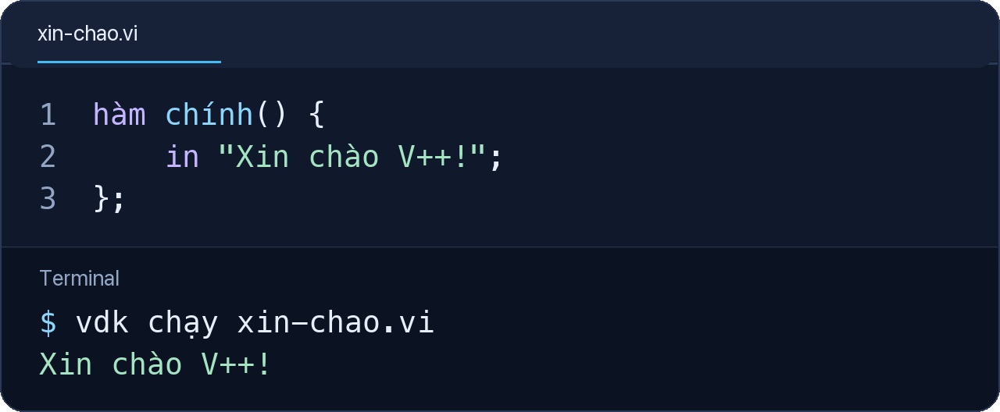
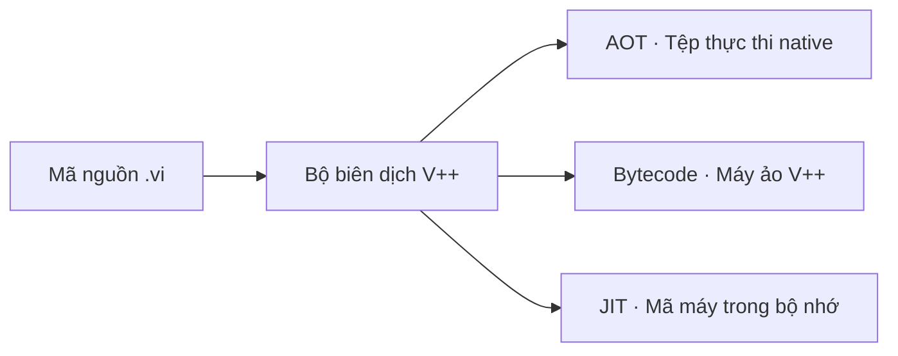

<div align="center">


# V++

**Ngôn ngữ lập trình mã nguồn mở với từ khóa và định danh tiếng Việt.**

[](https://github.com/winbiru/VXX/actions/workflows/native-vpp.yml)
[](https://github.com/winbiru/VXX/releases)
[](LICENSE)
[](https://github.com/winbiru/VXX/releases)
[](#cài-đặt-từ-vdk)

[](docs/compiler-self-hosting-status.md)
[](CMakeLists.txt)
[](#các-chế-độ-thực-thi)
[](vpp-libraries.json)
[](#kiểm-thử-và-chất-lượng)

[](#cài-đặt-từ-vdk)
[](#trạng-thái-nền-tảng)
[](#trạng-thái-nền-tảng)
[](INSTALL_EDITOR_HIGHLIGHT.md)
[](docs/language-reference.md)
[](docs/chuan-ngu-phap-tieng-viet.md)

[Bắt đầu](#cài-đặt-từ-vdk) · [Chạy thử](#chạy-thử) · [Tài liệu](#tài-liệu)

</div>

## Cài đặt từ VDK

VDK là bộ công cụ V++ gồm bộ biên dịch, runtime, thư viện chuẩn và CLI.

Chọn nền tảng để cài VDK **1.0.0**. Các lệnh lưu `PATH` và cấu hình UTF-8 cho tài khoản hiện tại để dùng `vpp` và `vdk` trong các terminal sau. [Bản phát hành `0.9.7`](https://github.com/winbiru/VXX/releases/tag/0.9.7)

<details>
<summary>macOS ARM64 (Apple Silicon)</summary>

```sh
version=1.0.0
url=https://github.com/winbiru/VXX/releases/download/0.9.7
archive="vdk-$version-macos-arm64.tar.gz"
sdk="$HOME/.vpp/vdk/$version"

download=$(mktemp -d) &&
  curl -fL "$url/$archive" -o "$download/$archive" &&
  curl -fL "$url/$archive.sha256" -o "$download/$archive.sha256" &&
  (cd "$download" && shasum -a 256 -c "$archive.sha256") &&
  mkdir -p "$HOME/.vpp/vdk" && mkdir "$sdk" &&
  tar -xzf "$download/$archive" -C "$sdk" &&
  export PATH="$sdk/bin:$PATH" &&
  vdk cai-hien-thi &&
  (
    sdk_bin='$HOME/.vpp/vdk/'"$version"'/bin'
    path_line=$(printf 'case ":$PATH:" in *":%s:"*) ;; *) export PATH="%s:$PATH" ;; esac' \
      "$sdk_bin" "$sdk_bin")
    case "${SHELL##*/}" in
      zsh) set -- "${ZDOTDIR:-$HOME}/.zshrc" ;;
      bash)
        login_profile="$HOME/.profile"
        if [ -f "$HOME/.bash_profile" ]; then
          login_profile="$HOME/.bash_profile"
        elif [ -f "$HOME/.bash_login" ]; then
          login_profile="$HOME/.bash_login"
        fi
        set -- "$HOME/.bashrc" "$login_profile" ;;
      *) set -- "$HOME/.profile" ;;
    esac
    for profile in "$@"; do
      if ! grep -Fxq "$path_line" "$profile" 2>/dev/null; then
        printf '\n%s\n' "$path_line" >> "$profile" || exit 1
      fi
    done
  ) &&
  vdk_locale=$(bash "$sdk/bin/vdk-display.sh" locale) &&
  export LANG="$vdk_locale" LC_CTYPE="$vdk_locale" &&
  if [ -n "${LC_ALL:-}" ] && [ "$(locale charmap 2>/dev/null)" != UTF-8 ]; then
    unset LC_ALL
  fi &&
  vdk check-display
```

</details>

<details>
<summary>Linux x86-64</summary>

```sh
version=1.0.0
url=https://github.com/winbiru/VXX/releases/download/0.9.7
archive="vdk-$version-linux-x64.tar.gz"
sdk="$HOME/.vpp/vdk/$version"

download=$(mktemp -d) &&
  curl -fL "$url/$archive" -o "$download/$archive" &&
  curl -fL "$url/$archive.sha256" -o "$download/$archive.sha256" &&
  (cd "$download" && sha256sum -c "$archive.sha256") &&
  mkdir -p "$HOME/.vpp/vdk" && mkdir "$sdk" &&
  tar -xzf "$download/$archive" -C "$sdk" &&
  export PATH="$sdk/bin:$PATH" &&
  vdk cai-hien-thi &&
  (
    sdk_bin='$HOME/.vpp/vdk/'"$version"'/bin'
    path_line=$(printf 'case ":$PATH:" in *":%s:"*) ;; *) export PATH="%s:$PATH" ;; esac' \
      "$sdk_bin" "$sdk_bin")
    case "${SHELL##*/}" in
      zsh) set -- "${ZDOTDIR:-$HOME}/.zshrc" ;;
      bash)
        login_profile="$HOME/.profile"
        if [ -f "$HOME/.bash_profile" ]; then
          login_profile="$HOME/.bash_profile"
        elif [ -f "$HOME/.bash_login" ]; then
          login_profile="$HOME/.bash_login"
        fi
        set -- "$HOME/.bashrc" "$login_profile" ;;
      *) set -- "$HOME/.profile" ;;
    esac
    for profile in "$@"; do
      if ! grep -Fxq "$path_line" "$profile" 2>/dev/null; then
        printf '\n%s\n' "$path_line" >> "$profile" || exit 1
      fi
    done
  ) &&
  vdk_locale=$(bash "$sdk/bin/vdk-display.sh" locale) &&
  export LANG="$vdk_locale" LC_CTYPE="$vdk_locale" &&
  if [ -n "${LC_ALL:-}" ] && [ "$(locale charmap 2>/dev/null)" != UTF-8 ]; then
    unset LC_ALL
  fi &&
  vdk check-display
```

</details>

<details>
<summary>Windows x86-64 (PowerShell)</summary>

```powershell
& {
    $version = "1.0.0"
    $url = "https://github.com/winbiru/VXX/releases/download/0.9.7"
    $archive = "vdk-$version-windows-x64.zip"
    $sdk = Join-Path $env:LOCALAPPDATA "VPP\vdk\$version"
    if (Test-Path -LiteralPath $sdk) { throw "Phiên bản VDK này đã được cài đặt" }

    $download = Join-Path ([IO.Path]::GetTempPath()) ("vdk-" + [guid]::NewGuid())
    New-Item -ItemType Directory -Path $download -ErrorAction Stop | Out-Null
    $zip = Join-Path $download $archive
    Invoke-WebRequest -UseBasicParsing -Uri "$url/$archive" -OutFile $zip -ErrorAction Stop
    Invoke-WebRequest -UseBasicParsing -Uri "$url/$archive.sha256" -OutFile "$zip.sha256" -ErrorAction Stop
    $expected = ((Get-Content "$zip.sha256" -Raw -ErrorAction Stop).Trim() -split '\s+')[0]
    $actual = (Get-FileHash -LiteralPath $zip -Algorithm SHA256 -ErrorAction Stop).Hash
    if ($actual -ne $expected) { throw "SHA-256 không khớp" }

    Expand-Archive -LiteralPath $zip -DestinationPath $sdk -ErrorAction Stop
    $bin = Join-Path $sdk 'bin'
    $env:Path = "$bin;$env:Path"

    $utf8 = [System.Text.UTF8Encoding]::new($false)
    [Console]::InputEncoding = $utf8
    [Console]::OutputEncoding = $utf8
    $global:OutputEncoding = $utf8
    vdk cai-hien-thi
    if ($LASTEXITCODE -ne 0) { throw "VDK chưa lưu được cấu hình UTF-8" }

    $userPath = [Environment]::GetEnvironmentVariable('Path', 'User')
    if (($userPath -split ';') -notcontains $bin) {
        $newPath = if ($userPath) { "$bin;$userPath" } else { $bin }
        [Environment]::SetEnvironmentVariable('Path', $newPath, 'User')
    }
    vdk check-display
}
```

</details>

Mở terminal mới và kiểm tra cả hai lệnh.

Trên Linux, lệnh `vpp` cần `clang` trong `PATH`.

```sh
vpp phiên bản
vdk phiên bản
vdk chẩn đoán
```

Dùng `vdk.json` để chọn phiên bản SDK cho từng dự án. [Hướng dẫn VDK](docs/installation.md#cài-đặt-vdk-và-chọn-phiên-bản-sdk)

Dùng `vdk remove-display` để hoàn tác cấu hình UTF-8 đã lưu. [Cấu hình UTF-8](docs/installation.md#cấu-hình-hiển-thị-tiếng-việt-utf-8)

### Trạng thái nền tảng

Xem mức kiểm chứng bootstrap theo hệ điều hành và kiến trúc. [Tài liệu bootstrap](bootstrap/README.md)

### Kiểm thử và chất lượng

Quy trình CI kiểm tra bootstrap, regression và chạy thử gói VDK trước khi phát hành. [Native CI](.github/workflows/native-vpp.yml)

## Chạy thử

Lưu đoạn mã sau vào tệp `xin-chao.vi`.

```vpp
hàm chính() {
    in "Xin chào V++!";
};
```

```sh
vdk chạy xin-chao.vi
```



Để tạo tệp thực thi native, chạy các lệnh sau.

```sh
vdk biên dịch xin-chao.vi --đầu-ra xin-chao
./xin-chao
```

Trên PowerShell, đặt đầu ra là `xin-chao.exe` rồi chạy `.\xin-chao.exe`.

## Các chế độ thực thi

Bộ biên dịch V++ có thể tự biên dịch từ mã nguồn của chính nó. Bộ công cụ được viết bằng V++ và Assembly, với ba chế độ thực thi.



## Tài liệu

- [Tham chiếu ngôn ngữ](docs/language-reference.md) và [các lệnh CLI](docs/cli.md).
- [Ứng dụng ví dụ](examples/) và [hỗ trợ VS Code](INSTALL_EDITOR_HIGHLIGHT.md).
- [Benchmark và cách chạy lại](benchmark/languages/README.md).
- [Hướng dẫn đóng góp](CONTRIBUTING.md) và [giấy phép MIT](LICENSE).
