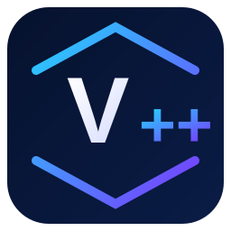

<div align="center">
  

# V++

### Ngôn ngữ lập trình tiếng Việt, có compiler, bytecode VM và toolchain riêng.

*Vietnamese-first programming language with its own compiler, bytecode VM and developer toolchain.*

Viết chương trình bằng cú pháp gần gũi với tiếng Việt, nhưng vẫn có những thành phần của một
ngôn ngữ thực tế: semantic analysis, IR, bytecode verifier, tracing GC, module/package system,
LSP, formatter, linter và bộ thư viện chuẩn.

[](https://github.com/winbiru/VXX/actions/workflows/native-vpp.yml)
[](https://github.com/winbiru/VXX/releases)
[](LICENSE)
[](CMakeLists.txt)

[🚀 Cài đặt](#-cài-v-trong-vài-phút) · [✨ Xem cú pháp](#-v-trông-như-thế-nào) · [🧰 Tooling](#-tooling-đi-kèm) · [📊 Benchmark](#-benchmark) · [🗺️ Roadmap](plans/roadmap-1.0.md) · [🤝 Đóng góp](CONTRIBUTING.md)
</div>

---

## Build bản tự chủ hiện tại

Nhánh này chỉ build compiler và runtime viết bằng V++/Assembly. Bootstrap đầy đủ hiện hỗ trợ macOS ARM64; các nền tảng khác và dịch vụ của CLI host cũ đang chờ chuyển đổi. Seed nằm trong `bootstrap/macos-arm64/`, được kiểm tra SHA-256, chữ ký và thư viện liên kết.

```sh
cmake -S . -B build-pure-vpp
cmake --build build-pure-vpp --parallel
ctest --test-dir build-pure-vpp --output-on-failure
./VPP phiên bản
./VPP build hello.vi -o hello
./VPP run hello.vi
make benchmark
```

Xem [hướng dẫn cài đặt](docs/installation.md) và [nguồn gốc seed](bootstrap/README.md). Các binary build cũ trong `build/`, `bin/` không được launcher mới sử dụng.

`make benchmark` hiện đo sáu workload của V++ AOT trực tiếp; chưa tự build lại các ngôn ngữ đối chứng. Tệp `benchmark/languages/workloads.c` chỉ là nguồn đối chứng độc lập, không thuộc quy trình build V++. Bộ test native hiện tập trung vào smoke test; các fixture lịch sử được giữ để chuyển đổi dần.

<details>
<summary>Tài liệu và tính năng của kiến trúc trước khi loại bỏ host C++ (tham khảo lịch sử)</summary>

## V++ là gì?

V++ là một ngôn ngữ lập trình dynamic-typed được xây dựng từ đầu với **cú pháp tiếng Việt và
Unicode là công dân hạng nhất**.

Mục tiêu của dự án không chỉ là đổi keyword sang tiếng Việt. V++ đang xây dựng đầy đủ một stack:

```text
Mã nguồn V++
    ↓
Lexer → Parser → AST → Semantic Analysis
    ↓
Untyped IR → Optimizer → Bytecode
    ↓
Bytecode Verifier → V++ VM → Tracing GC
```

V++ phù hợp nếu bạn quan tâm tới compiler/VM, thiết kế ngôn ngữ, runtime, hoặc đơn giản muốn thử
một ngôn ngữ mà code tiếng Việt trông tự nhiên hơn.

## ✨ V++ trông như thế nào?

```vi
hàm chào(tên) {
    trả về "Xin chào, " + tên + "!";
};

hàm chính() {
    in chào("Việt Nam");

    lặp(i = 1; i <= 5; i++) {
        nếu (i % 2 == 0) {
            in "Số chẵn: " + i;
        };
    };
};
```

Class, kế thừa và interface cũng dùng cú pháp tiếng Việt:

```vi
giao diện CóTên {
    hàm tên();
}

lớp SảnPhẩm triển khai CóTên {
    hàm khởi tạo(tên) {
        mình.tênSảnPhẩm = tên;
    };

    hàm tên() {
        trả về mình.tênSảnPhẩm;
    };
}

hàm chính() {
    càPhê = SảnPhẩm("Cà phê Việt Nam");
    in càPhê.tên();
};
```

Xem đầy đủ tại [Language Reference](docs/language-reference.md).

## 🔥 Có gì đáng chú ý?

| Thành phần | V++ hiện có |
| --- | --- |
| Ngôn ngữ | Hàm, lambda/closure, list/map, exception, class, inheritance, interface, visibility |
| Compiler | Lexer, parser, semantic analysis, IR, optimizer, bytecode codegen |
| Runtime | Bytecode VM, verifier, stack trace, module lifecycle, tracing GC |
| Package | `vpp.json`, SemVer, deterministic `vpp.lock`, cache/offline, path/Git/registry package |
| Stdlib | Text/Unicode, collection, JSON, file/path, time, HTTP, SQL và nhiều module mở rộng |
| Tooling | Formatter, linter, AST/IR dump, REPL, LSP, VS Code integration |
| Platforms | Windows, macOS và Linux |

Một vài điểm V++ tập trung mạnh:

- **Tiếng Việt thật sự trong source**: identifier có dấu, `mình`, `gốc`, `nếu`, `lặp`, `thử`, `bắt lỗi`…
- **Không chỉ là transpiler**: V++ có bytecode format nội bộ và VM riêng.
- **Runtime có verifier + tracing GC**: bytecode được kiểm tra trước khi thực thi và object graph có cycle collection.
- **Compiler có IR thật**: frontend, semantic, IR và codegen được tách thành các tầng rõ ràng.
- **Package reproducible**: dependency được khóa bằng version + fingerprint trong `vpp.lock`.
- **Developer tooling đi cùng ngôn ngữ**: formatter, linter, REPL và LSP dùng chung semantic model.

## 🚀 Cài V++ trong vài phút

> V++ đang tiến tới mốc 1.0. Build metadata trên nhánh phát triển có thể đi trước release final;
> xem [Roadmap 1.0](plans/roadmap-1.0.md) để biết trạng thái release gate hiện tại.

### macOS

```bash
curl -L https://github.com/winbiru/VXX/releases/latest/download/vpp-macos.tar.gz -o vpp-macos.tar.gz
tar -xzf vpp-macos.tar.gz
./install-vpp.sh
```

### Linux x64

```bash
curl -L https://github.com/winbiru/VXX/releases/latest/download/vpp-linux-x64.tar.gz -o vpp-linux-x64.tar.gz
tar -xzf vpp-linux-x64.tar.gz
./install-vpp.sh
```

### Windows PowerShell

```powershell
Invoke-WebRequest -Uri "https://github.com/winbiru/VXX/releases/latest/download/vpp-windows-x64.zip" -OutFile "vpp-windows-x64.zip"
Expand-Archive -Path "vpp-windows-x64.zip" -DestinationPath ".\vpp-bin" -Force
.\vpp-bin\install-vpp.cmd
```

**Chỉ cần chạy installer một lần.** Installer tự cài binary, stdlib, templates/examples, cấu hình
`PATH`, `VPP_HOME` và UTF-8/locale cho shell phù hợp. Cài lại dùng cùng installer để cập nhật và
không nhân đôi block cấu hình. Sau khi cài, mở terminal mới và chạy:

```text
vpp phiên bản
vpp chẩn đoán
```

Trên Windows, installer ghi block có marker vào PowerShell `CurrentUserAllHosts` profile để các
PowerShell mở sau đó tự dùng code page 65001, UTF-8 input/output và `LANG=vi_VN.UTF-8`. Trên
macOS/Linux, installer ưu tiên `vi_VN.UTF-8`; nếu hệ thống chưa có locale này thì chọn một locale
UTF-8 đang tồn tại. Uninstaller chỉ xóa cấu hình do V++ quản lý.

Chi tiết cài đặt, cập nhật, gỡ cài đặt và troubleshooting nằm trong
[docs/installation.md](docs/installation.md).

## ⚡ Chạy chương trình đầu tiên

Tạo `xin-chao.vi`:

```vi
hàm chính() {
    in "Xin chào V++!";
    in "2 + 3 = " + (2 + 3);
};
```

Sau đó:

```bash
vpp chạy xin-chao.vi
```

Hoặc tạo hẳn một project:

```bash
vpp khởi tạo ứng dụng hello-vpp
cd hello-vpp
vpp dựng src/chính.vi
vpp chạy src/chính.vi
vpp kiểm thử tests
```

## 🧰 Tooling đi kèm

```bash
vpp chạy app.vi                 # chạy source
vpp dựng app.vi                 # chạy compiler pipeline
vpp kiểm thử tests              # chạy test project
vpp --soát-lỗi src/             # linter
vpp --định-dạng src/ --kiểm-tra # formatter check
vpp --dump-ast app.vi           # xem AST
vpp --dump-ir app.vi            # xem IR
vpp --giải-mã app.vi            # disassemble bytecode
vpp --repl                      # REPL
vpp --lsp                       # language server
vpp chẩn đoán                   # kiểm tra môi trường
```

CLI dùng tên tiếng Việt làm contract chính; các alias quen thuộc như `run`, `build`, `test`,
`new` vẫn được giữ để tương thích.

### VS Code

Repo có extension hỗ trợ `.vi` với syntax highlighting và LSP cho:

- diagnostic;
- completion;
- go-to-definition;
- hover;
- rename;
- format.

Cài extension local:

```bash
./scripts/vpp-lang self-install
vpp-lang install --editor vscode
```

Sau đó reload VS Code và mở file `.vi`.

## 📦 Package system

Project V++ dùng `vpp.json` và `vpp.lock`:

```bash
vpp gói cài đặt ./thu-vien-cua-toi
vpp gói cài đặt git+https://github.com/example/pkg.git#main
vpp gói cập nhật
vpp gói khóa
vpp gói phục hồi --ngoại-tuyến
```

Package manager hỗ trợ SemVer range, dependency transitive, deterministic lockfile, cache offline,
local path, Git source và filesystem registry.

Đọc thêm: [Package System](docs/package-system.md).

Gói thử nghiệm `lượng tử` hỗ trợ dựng mạch, mô phỏng vector trạng thái phức,
phép đo/reset và xuất OpenQASM 3.0. Chạy ví dụ Bell bằng
`vpp chạy examples/luong-tu/bell.vi`; xem [API và cầu nối Qiskit](docs/thư-viện-vpp/lượng%20tử/chính.md).

## 🧪 Build từ source

Yêu cầu chính: compiler C++17 và CMake.

```bash
git clone https://github.com/winbiru/VXX.git
cd VXX
cmake -S . -B build -DCMAKE_BUILD_TYPE=Release
cmake --build build --parallel
ctest --test-dir build --output-on-failure --no-tests=error
```

Binary nằm tại:

```text
build/bin/vpp-cli
```

Chạy trực tiếp:

```bash
./build/bin/vpp-cli chạy src/tests/program.vi
```

Windows có thể build bằng MSVC/CMake; hướng dẫn chi tiết nằm trong
[docs/installation.md](docs/installation.md).

## 📊 Benchmark

Đo lại ngày **14/11/2026** trên **macOS 26.6.2 ARM64**, với compiler V++
tự biên dịch từ source hiện tại (commit `e25e289`, cây làm việc có thay đổi).
Có **120/120 mẫu hợp lệ** từ 40 tổ hợp runtime/bài đo, mỗi tổ hợp chạy 3
tiến trình độc lập, ba batch làm nóng rồi một batch đo. Thứ tự chạy được
xáo trộn; số vòng được hiệu chỉnh với mục tiêu 30 ms/batch. Đã kiểm tra
16 đầu ra, checksum, SHA-256 của manifest/executable/source benchmark và
tính lại trung vị/MAD; **MAD/trung vị cao nhất 5,27%**.

**Trung vị µs/thao tác; thấp hơn là nhanh hơn.** Ứng dụng V++ được dựng lại
bằng compiler mới, dùng **runtime V++/ASM**, sinh executable Mach-O trực tiếp
và chỉ liên kết `libSystem`. C/C++ dùng Apple Clang 21 `-O3`, không LTO;
Node.js 20.11.1 và Java 21.0.2 dùng JIT mặc định; Python 3.14.3 và Ruby
2.6.10 dùng cấu hình mặc định. Tất cả chạy ARM64.

| Ngôn ngữ | Số học | Vòng lặp có nhánh | Fibonacci vòng lặp | Danh sách 128 phần tử | Thay Unicode | Phân tích JSON |
| --- | ---: | ---: | ---: | ---: | ---: | ---: |
| **V++ AOT + V++/ASM** | **0.001819** | **0.157942** | **0.023724** | **0.135456** | **9.028943** | **114.011029** |
| C | 0.000891 | 0.212832 | 0.009547 | — | — | — |
| C++ | 0.000888 | 0.216138 | 0.009672 | 0.257593 | 0.202375 | — |
| Node.js | 0.001175 | 0.160358 | 0.012886 | 0.564026 | 1.411153 | 0.455664 |
| Java | 0.001481 | 0.073471 | 0.004704 | 0.494766 | 0.230724 | — |
| Python | 0.101685 | 4.596722 | 0.491839 | 5.573257 | 0.504202 | 2.124389 |
| Ruby | 0.083673 | 6.649590 | 1.109959 | 8.044760 | 1.364958 | 2.407891 |

Dấu `—` nghĩa là bộ đo chưa có bài tương ứng: C chỉ có ba kernel số học;
C++/Java chưa có bài JSON. Rust không có `rustc` trên máy trong lượt đo này,
nên không đưa số liệu Rust cũ vào bảng. Các ngôn ngữ dùng cấu trúc dữ liệu
và thư viện bản địa tương ứng; JSON so sánh cả hiệu quả của thư viện parser.
Mã đối chứng C++ và driver C/i32 được lấy từ commit `35aa30e`, trước khi
loại bỏ các tệp C++ khỏi cây nguồn, và dựng lại riêng cho lần đo này.

Trong các bài đã đo, danh sách V++ nhanh hơn C++ khoảng **1,90 lần**,
vòng lặp có nhánh nhanh hơn C khoảng **1,35 lần**;
Fibonacci mất khoảng **2,49 lần thời gian C**.
Unicode mất khoảng **44,61 lần thời gian C++**,
JSON mất khoảng **250,21 lần thời gian Node.js**.
Các tỷ lệ chỉ áp dụng cho từng workload, không phải hệ số tốc độ chung.

So với bảng ngày 05/11/2026, thời gian Unicode giảm từ 82,25 xuống
9,03 µs, JSON giảm từ 1.003,27 xuống
114,01 µs. Hai lượt đo khác cấu hình batch và số mẫu,
nên đây là đối chiếu tham khảo, không phải phép đo A/B cô lập tối ưu.

Các kernel V++ i32 riêng dùng chung bộ đo C++ và ABI bốn tham số i32 với C,
biên dịch ở đơn vị riêng, không LTO. **Đơn vị ns/thao tác**:

| Kernel | V++ i32 | C |
| --- | ---: | ---: |
| Số học | 1.302 | 0.891 |
| Vòng lặp có nhánh | 157.469 | 212.832 |
| Fibonacci vòng lặp | 21.975 | 9.547 |

Ứng dụng AOT ở bảng đầu dùng bộ đo viết bằng V++; đường kernel i32 dùng
driver C++. Cấu trúc vòng lặp và tối ưu có thể khác nhau, nên không lấy
hiệu hai bảng để suy ra chi phí riêng của một lời gọi hàm.

Phép đo không tính khởi động, biên dịch, chuẩn bị đầu vào hay làm nóng;
vẫn tính vòng lặp bộ đo, gọi hàm, cấp phát và GC còn lại sau tối ưu.
Đầu vào lặp theo chu kỳ 16 giá trị `17..32`; profiling tắt khi đo.
Các batch đo dài 21,37–41,28 ms. Kiểm thử bootstrap compiler chạy
đồng thời trên máy, nên kết quả có thể chịu ảnh hưởng của tải nền;
chưa phải phép đo trên máy hoàn toàn nhàn rỗi. Chưa đo riêng RAM, I/O,
đa luồng hay thời gian biên dịch.

[Mã nguồn workload](benchmark/languages/)
· [Bộ đo, oracle và thống kê](scripts/quality/compare_languages_aot.py).
Báo cáo gốc: `benchmark/reports/languages-2026-11-14-refresh.json`;
manifest: `build-benchmark-2026-11-14-refresh/manifest.json` (tệp cục bộ,
được `.gitignore` bỏ qua). SHA-256 báo cáo: `9a8db89495a73636b3afb33fdf91c970417f70415bd07d7b6c79d4576d08b0b9`.

## 🧠 Kiến trúc

V++ chia source C++ thành các module riêng:

```text
vpp-core
   ↓
vpp-bytecode
   ↓
vpp-frontend
   ↓
vpp-compiler ──→ vpp-tooling
   ↓
vpp-runtime
   ↓
vpp-cli
```

Các package viết bằng V++ nằm dưới `gói/`, còn native runtime chỉ giữ những primitive cần tương
tác với hệ điều hành hoặc host runtime.

Xem chi tiết: [Architecture](docs/architecture.md) · [Bytecode](docs/bytecode.md) ·
[Semantics](docs/semantics.md) · [Runtime Errors](docs/runtime-errors.md).

## 🗺️ Trạng thái 1.0

V++ đã có phần lớn nền tảng của 1.0: semantics, object model, compiler pipeline, VM, package system,
toolchain và documentation. Công việc còn lại tập trung vào hardening release:

- same-machine performance baseline/candidate regression gate;
- GC allocation/RSS/p95 telemetry;
- Linux ASan/UBSan/LSan evidence;
- artifact install smoke trên Windows/macOS/Linux;
- audit bề mặt stdlib stable trước final.

Theo dõi checklist đầy đủ tại [Roadmap V++ 1.0](plans/roadmap-1.0.md) và
[Quality Gates](docs/quality.md).

## 🧩 Ví dụ trong repo

- `examples/hoa-don-cua-hang` — module, class/constructor và import tương đối.
- `examples/quan-ly-kho-api` — sample backend/HTTP lớn hơn để kiểm tra package + runtime.
- `src/tests/` — regression corpus của compiler và VM.

## 🤝 Đóng góp

Compiler, runtime, stdlib, tooling và documentation đều có chỗ để đóng góp.

Nếu bạn muốn bắt đầu nhanh:

1. Fork repository.
2. Chọn một issue hoặc một mục trong [Roadmap](plans/roadmap-1.0.md).
3. Build và chạy CTest trước khi sửa.
4. Thêm regression khi thay đổi behavior.
5. Gửi pull request với mô tả rõ trước/sau.

Đọc [CONTRIBUTING.md](CONTRIBUTING.md) để biết quy ước chi tiết.

## ⭐ Nếu bạn thấy V++ thú vị

Hãy **Star** repo để theo dõi quá trình đưa một ngôn ngữ lập trình tiếng Việt từ compiler/VM thử
nghiệm tới mốc 1.0, hoặc chia sẻ V++ cho những người quan tâm tới compiler, VM và language design.

Ý tưởng, bug report và pull request đều được hoan nghênh.

## 📚 Tài liệu

- [Language Reference](docs/language-reference.md)
- [CLI](docs/cli.md)
- [Package System](docs/package-system.md)
- [Testing](docs/testing.md)
- [Installation](docs/installation.md)
- [Architecture](docs/architecture.md)
- [Debugging](docs/debugging.md)
- [Migration to 1.0](docs/migration-1.0.md)
- [Roadmap 1.0](plans/roadmap-1.0.md)
- [Changelog](CHANGELOG.md)
  
## Thông điệp
V++ — Lập trình bằng tiếng Việt, kết nối với công nghệ thế giới.
V++ được phát triển với mong muốn tiếng Việt có thể trở thành một phương tiện biểu đạt tư duy lập trình và xây dựng phần mềm hiện đại.
Chúng tôi không phát triển V++ để phủ nhận Python, Java, C++ hay bất kỳ ngôn ngữ lập trình nào khác. Mỗi ngôn ngữ đều có giá trị, lịch sử và lĩnh vực ứng dụng riêng.
V++ hướng tới việc mở rộng sự lựa chọn: để người Việt có thể học tập, nghiên cứu và sáng tạo phần mềm bằng chính tiếng mẹ đẻ, đồng thời tương tác với các tiêu chuẩn và hệ sinh thái công nghệ quốc tế.
tôi hiểu rằng V++ còn nhiều điều cần hoàn thiện. Mọi phản biện kỹ thuật, góp ý thiết kế và đóng góp mã nguồn đều được trân trọng.
tôi không mong mọi người đồng ý với V++. tôi mong V++ được đánh giá bằng những gì nó thực sự làm được. 
Bản sắc V++ không có nghĩa là khép mình trước thế giới. Đó là khả năng đóng góp vào thế giới bằng bản sắc của chính mình.

## License

V++ được phát hành theo giấy phép [MIT](LICENSE).


</details>
